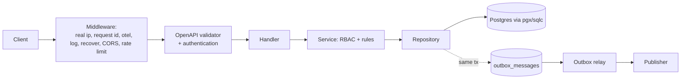

# Architecture

## Layout

```
cmd/
  api/        composition root: load config, wire dependencies, serve
  migrate/    apply migrations as an explicit deploy step
  forge/      day-2 generator: go run ./cmd/forge add resource <Name>
  dev/        pinned tool bootstrap and verification commands
internal/
  config/         typed, validated environment configuration
  observability/  slog (trace correlation + redaction), OpenTelemetry, Prometheus
  platform/
    database/   pgx pool and transaction helper
    problem/    RFC 9457 problem+json responses
  server/         http.Server, middleware, router, health, graceful drain
  auth/           JWKS/RSA verification, RBAC, OpenAPI authenticator
  modules/        one package per resource (SQL, store, service, handler)
  gen/            generated code (sqlc + oapi-codegen), committed
  testutil/       isolated Postgres databases, Docker or an external test server
api/openapi.yaml  the API contract, source of truth
migrations/       versioned SQL, embedded into the binaries
deployments/      Dockerfile and Docker Compose configuration
```

<!-- forge:begin init -->
`forge init` removes unselected components and its own installer.
<!-- forge:end init -->

## Request flow



A request passes global middleware, then the OpenAPI validator checks it against
`api/openapi.yaml` and runs the bearer authentication function for protected
operations. The handler maps transport types to the service, which enforces
authorization before calling the repository.
<!-- forge:begin outbox -->
Writes that emit events persist the event to `outbox_messages` in the same
transaction; a relay publishes them at-least-once and, while batches come back
full, keeps draining within a tick. A message the publisher rejects records the
attempt and error and backs off (up to an hour between tries) without holding
up the rest, so delivery order is not guaranteed and consumers must be
idempotent.

The default `outbox.LogPublisher` logs event metadata and treats delivery as
successful. Replace it in `cmd/api/main.go` with a broker or webhook `Publisher`
when the application needs external delivery.
<!-- forge:end outbox -->

## Boundaries

- The repository sits behind an interface, so business logic is unit-tested
  with a fake. The router and logger are the standard `http.Handler` and
  `*slog.Logger` types; there is no seam that exists only to satisfy a pattern.
- `internal/gen` is generated and never edited by hand. CI fails if it drifts
  from `migrations/`, the query files, or `api/openapi.yaml`.
- Each resource is one package (a vertical slice), which keeps blast radius small
  for domain changes. The generator also updates the shared contract, SQL
  registration, and explicit handler composition in `cmd/api`.
- Resource operations use the same OpenAPI validation path. The composition
  layer delegates each operation to its module's handler; it contains wiring,
  not business rules.

## Observability

Every log line and problem response carries the trace ID of the active span, so
a log backend can link a line to its trace. Metrics are exposed at `/metrics`
for Prometheus.
<!-- forge:begin otlp -->
Spans are exported when `FORGE_OTEL_OTLP_ENDPOINT` is set; `task observe` runs
a Collector, Tempo, Prometheus and Grafana to receive them.
<!-- forge:end otlp -->

`/metrics`, `/livez`, and `/readyz` are unauthenticated on the public listener,
which is the usual Prometheus and Kubernetes-probe convention; restrict them at
the network layer in production.
<!-- forge:begin admin -->
pprof and expvar are kept off the public listener entirely, on a separate
token-gated admin server.
<!-- forge:end admin -->
